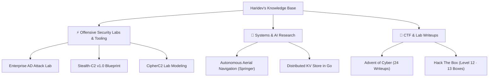

# 👋 Welcome | Haridev's Security Knowledge Base

> **Offensive Security Specialist · Security Research Intern @ ASTRA Lab (CyStar), IIT Madras · Systems Engineer**

---

### 🧠 Operator Philosophy

> *"This repository is not a sterile archive—it is my technical brain, tradecraft playbooks, and systems research compiled into a living knowledge base. Everything documented here is dissected down to protocol frames, API calls, and kernel telemetry: not just what commands to run, but the underlying mechanisms of why they succeed."*

Welcome to my personal offensive security knowledge base. Here you will find detailed research on **Active Directory lab simulation**, **covert Command & Control (C2) design**, **distributed systems engineering**, and **hands-on challenge walkthroughs**.

---

### ⚡ Verified Credentials & Research Engagements

| Verification | Detail | Context & Scope |
| :--- | :--- | :--- |
| **Research Appointment** | **ASTRA Lab (CyStar), IIT Madras** | Advised by Prof. Narayanaswamy N S & Dr. Jaimandeep Singh (Senior Consultant, ex-MoD) |
| **Lab Project** | **CipherC2 Initiative** | Modeling adversary Command & Control TTPs aligned with MITRE ATT&CK |
| **Peer-Reviewed Research** | **Springer LNNS / Scopus-Indexed** | Corresponding Author: Autonomous Navigation & RL (SCRS CIMA 2026, NIT Puducherry) |
| **TryHackMe** | **24 Writeups Documented (`ArtemizZ`)** | 24 machine walkthroughs documented; full Advent of Cyber completion |
| **Hack The Box** | **Level 12 (`Level 12`)** | 13 rooted boxes across Linux and Windows enterprise paths |
| **Academic Background** | **B.Tech Computer Science & Engineering** | Amrita Vishwa Vidyapeetham (CGPA: 7.1) |

---

### 🗺️ Knowledge Base Index

---

### 📂 Quick Navigation by Specialty

#### ⚡ Offensive Security Labs & Tooling
Engineering and simulating enterprise attack surfaces and covert communication channels.
* 👉 [Enterprise Active Directory Attack Lab (4-Machine Kill Chain)](ad/active-directory.md)
* 👉 [Stealth-C2 v1.0 Blueprint: Discord HTTPS & AES-256-GCM](c2/stealth-c2.md)
* 👉 [CipherC2 Research Initiative (ASTRA Lab, IIT Madras)](c2/cipher-c2.md)

#### 🔬 Systems & AI Research
Peer-reviewed computer science publications and systems engineering implementations in Go.
* 👉 [Autonomous Navigation & RL (Springer LNNS Scopus Publication)](research/autonomous-navigation.md)
* 👉 [Distributed Key-Value Engine in Go (Raft Consensus & Sharding)](research/distributed-systems.md)

#### 🎯 Challenge Writeups & Labs
Step-by-step technical walkthroughs of machines, challenges, and offensive methodology.
* 👉 [TryHackMe: Advent of Cyber 2025 (Days 1–24 Complete)](writeups/advent-of-cyber/README.md)
* 👉 [Hack The Box Methodology (Level 12 · 13 Boxes)](writeups/hack-the-box.md)

---

### ⚠️ Rules of Engagement & Responsible Disclosure

> [!CAUTION]
> **Strictly for Authorized Testing and Educational Research**
> 
> All technical methodologies, code examples, payloads, and architectural breakdowns presented in this GitBook are authored exclusively for authorized security research, academic study, and sanctioned penetration testing / red teaming assessments.
> 
> Executing any of the described attacks against systems without explicit, prior, written permission from the asset owner is illegal and unethical. The author accepts zero liability for misuse of the material contained herein.
