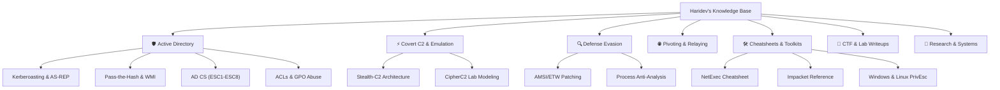

# 👋 Welcome | Haridev's Security Knowledge Base

> **Offensive Security Specialist · Security Research Intern @ ASTRA Lab (CyStar), IIT Madras · Systems Engineer**

---

### 🧠 Operator Philosophy

> *"This repository is not a sterile archive—it is my technical brain, tradecraft playbooks, and systems research compiled into a living knowledge base. Everything documented here is dissected down to protocol frames, API calls, and kernel telemetry: not just what commands to run, but the underlying mechanisms of why they succeed."*

Welcome to my personal offensive security knowledge base. Here you will find detailed research on **Active Directory exploitation**, **covert Command & Control (C2) design**, **Windows internals and defense evasion**, **network pivoting**, and **hands-on challenge walkthroughs**.

---

### ⚡ Verified Credentials & Research Engagements

| Verification | Detail | Context & Scope |
| :--- | :--- | :--- |
| **Research Appointment** | **ASTRA Lab (CyStar), IIT Madras** | Advised by Prof. Narayanaswamy N S & Dr. Jaimandeep Singh (Senior Consultant, ex-MoD) |
| **Lab Project** | **CipherC2 Initiative** | Modeling adversary Command & Control TTPs aligned with MITRE ATT&CK |
| **Peer-Reviewed Research** | **Springer LNNS / Scopus-Indexed** | Corresponding Author: Autonomous Navigation & RL (SCRS CIMA 2026, NIT Puducherry) |
| **TryHackMe** | **Top 30% Globally (`ArtemizZ`)** | 24 machine walkthroughs documented; full Advent of Cyber completion |
| **Hack The Box** | **Level 12 (`Level 12`)** | 13 rooted machines across Linux and Windows enterprise paths |
| **Academic Background** | **B.Tech Computer Science & Engineering** | Amrita Vishwa Vidyapeetham (CGPA: 7.1) |

---

### 🗺️ Knowledge Base Index

---

### 📂 Quick Navigation by Specialty

#### 🛡️ Active Directory Exploitation
Exhaustive walkthroughs of enterprise identity infrastructure attacks, from initial network footholds to complete Domain Forest dominance.
* 👉 [Active Directory Overview & Attack Lifecycle](ad/active-directory.md)
* 👉 [Kerberoasting & AS-REP Roasting Deep-Dive](ad/kerberoasting.md)
* 👉 [Lateral Movement & Relaying Tradecraft](ad/lateral-movement.md)
* 👉 [Active Directory Certificate Services (AD CS) Attacks](ad/adcs-attacks.md)
* 👉 [ACL Abuse & Group Policy Object (GPO) Persistence](ad/acl-gpo-abuse.md)

#### ⚡ Covert Command & Control (C2)
Designing covert egress channels that blend seamlessly into legitimate cloud SaaS traffic and bypass perimeter egress filtering.
* 👉 [Adversary Emulation & C2 Architecture](c2/adversary-emulation.md)
* 👉 [Stealth-C2 v1.0 Blueprint: Discord HTTPS & AES-256-GCM](c2/stealth-c2.md)
* 👉 [CipherC2 Research Initiative (ASTRA Lab, IIT Madras)](c2/cipher-c2.md)

#### 🔍 Defense Evasion & Windows Internals
Mechanisms used by modern EDRs and blue teams, along with memory patching and anti-analysis tradecraft.
* 👉 [Defense Evasion Strategies](evasion/defence-evasion.md)
* 👉 [AMSI & ETW Patching Mechanics](evasion/amsi-etw-patching.md)
* 👉 [Anti-Analysis, Sandbox Evasion & Kill Switches](evasion/anti-analysis.md)

#### 🌐 Network Pivoting & Tunneling
Moving across segmented subnets, dual-homed bastion hosts, and firewalled enclaves.
* 👉 [Network Pivoting Playbook (Chisel, Ligolo-ng, SSH, Netsh)](pivoting/pivoting-guide.md)

#### 🛠️ Operator Toolkits & Cheatsheets
Field-tested commands, battle-tested syntax, and quick operator references for everyday engagements.
* 👉 [NetExec (nxc) Operator Cheatsheet](toolkits/netexec-cheatsheet.md)
* 👉 [Impacket Toolkit Reference Manual](toolkits/impacket-reference.md)
* 👉 [Windows Privilege Escalation Playbook](toolkits/privilege-escalation.md)
* 👉 [Linux Privilege Escalation Playbook](toolkits/linux-privesc.md)
* 👉 [Offensive Security General Cheatsheet](toolkits/cheat-sheet.md)

#### 🎯 CTF & Lab Walkthroughs
Step-by-step technical walkthroughs of machines, challenges, and guided learning tracks.
* 👉 [TryHackMe: Advent of Cyber 2025 (Days 1–24 Complete)](writeups/advent-of-cyber/README.md)
* 👉 [Hack The Box Machine Methodology](writeups/hack-the-box.md)

#### 🔬 Research & Systems Engineering
Peer-reviewed computer science publications and systems engineering implementations in Go.
* 👉 [Autonomous Navigation & RL (Springer LNNS Publication)](research/autonomous-navigation.md)
* 👉 [Distributed Key-Value Engine in Go](research/distributed-systems.md)

---

### ⚠️ Rules of Engagement & Responsible Disclosure

> [!CAUTION]
> **Strictly for Authorized Testing and Educational Research**
> 
> All technical methodologies, code examples, payloads, and architectural breakdowns presented in this GitBook are authored exclusively for authorized security research, academic study, and sanctioned penetration testing / red teaming assessments.
> 
> Executing any of the described attacks against systems without explicit, prior, written permission from the asset owner is illegal and unethical. The author accepts zero liability for misuse of the material contained herein.
