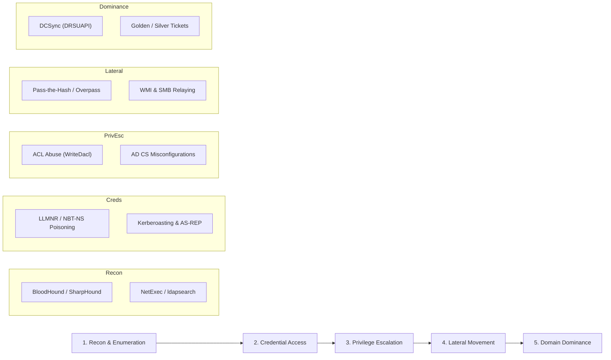

# 🛡️ Active Directory Architecture & Attack Lifecycle

Active Directory Domain Services (AD DS) is the identity and authorization foundation of modern enterprise networks. Auditing and red teaming Active Directory requires a deep understanding of domain trust boundaries, Kerberos authentication states, and Access Control Lists (ACLs).

---

### Enterprise AD Architecture & Protocols

```text
+-----------------------------------------------------------------------------------+
|                              ENTERPRISE AD FOREST                                 |
|                                                                                   |
|   +-----------------------+              Kerberos (Port 88)                       |
|   | CORP-DC01 (KDC, LDAP) | <===========================================+         |
|   | 192.168.56.10         |                                             |         |
|   +-----------------------+                                             |         |
|         |           |                                                   |         |
|   LDAP  |           | SMB (445)                                         |         |
|   (389) |           | WMI/RPC (135)                                     |         |
|         v           v                                                   v         |
|   +---------------+   Pass-the-Hash    +---------------+  LLMNR Poison +--------+ |
|   |   CORP-WS01   | -----------------> |   CORP-WS02   | <------------ |  KALI  | |
|   | 192.168.56.20 |   (wmiexec.py)     | 192.168.56.21 |   (Responder) | ATTACK | |
|   +---------------+                    +---------------+               +--------+ |
+-----------------------------------------------------------------------------------+
```

#### Core Components & Services

| Service | Port | Function in Domain Operations |
| :--- | :--- | :--- |
| **Kerberos (KDC)** | `88/TCP/UDP` | Issues Ticket Granting Tickets (TGT) and Service Tickets (TGS). |
| **LDAP / LDAPS** | `389/TCP`, `636/TCP` | Directory query interface for users, computers, groups, and ACLs. |
| **SMB** | `445/TCP` | File sharing, Named Pipe transport, remote administration (RPC over SMB). |
| **RPC / Endpoint Mapper** | `135/TCP` | Service discovery and dynamic port binding for WMI, DCOM, and DRSUAPI. |
| **DNS** | `53/TCP/UDP` | Service locator records (`_kerberos._tcp`, `_ldap._tcp`) for DC discovery. |
| **Global Catalog** | `3268/TCP` | Multi-domain forest index for cross-domain object search. |

---

### The 5-Phase AD Attack Lifecycle



---

### Phase 1: High-Efficiency Domain Enumeration

#### 1. Unauthenticated / Null-Session Enumeration
When connected to an internal network segment without domain credentials:

```bash
# Discover active Domain Controllers via DNS SRV records
nslookup -type=srv _ldap._tcp.corp.local 192.168.56.10

# Null session RPC enumeration
rpcclient -U "" -N 192.168.56.10
rpcclient $> enumdomusers
rpcclient $> querydispinfo
rpcclient $> netshareenumall
```

#### 2. Authenticated Domain Mapping with NetExec (`nxc`)

```bash
# Verify credentials across all subnets
nxc smb 192.168.56.0/24 -u 'jdoe' -p 'Welcome2025!'

# Enumerate password policy (crucial before password spraying to avoid lockouts)
nxc smb 192.168.56.10 -u 'jdoe' -p 'Welcome2025!' --pass-pol

# Enumerate all logged-on users and active sessions
nxc smb 192.168.56.0/24 -u 'jdoe' -p 'Welcome2025!' --loggedon-users

# Dump domain users and descriptions (often contain passwords left by helpdesk)
nxc ldap 192.168.56.10 -u 'jdoe' -p 'Welcome2025!' --users
```

#### 3. Graphing Attack Paths with BloodHound

```bash
# Execute SharpHound collector from a domain-joined endpoint
SharpHound.exe -c All,GPOLocalGroup --zipfilename domain_collection.zip

# Execute Python collector remotely via LDAP
bloodhound-python -u 'jdoe' -p 'Welcome2025!' -d corp.local -ns 192.168.56.10 -c All
```

> [!TIP]
> In BloodHound, look for:
> * `Find Shortest Paths to Domain Admins`
> * `Find Principals with DCSync Rights`
> * `Find Computers with Unconstrained Delegation`

---

### Blue Team Telemetry & Event Correlation

Auditing AD infrastructure requires ingesting and correlating specific Windows Security Event IDs:

| Event ID | Event Description | Offensive Indicator |
| :--- | :--- | :--- |
| **4624** | Successful Logon | Type 3 = Network (SMB, WMI, RPC); Type 10 = Remote Desktop (RDP). |
| **4672** | Special Privileges Assigned | Indicates logon by privileged account (`SeDebugPrivilege`, Administrator). |
| **4768** | Kerberos TGT Request | Monitored for AS-REP roasting (pre-auth disabled). |
| **4769** | Kerberos Service Ticket (TGS) Request | Filter for `Ticket Encryption: 0x17` (RC4) indicating Kerberoasting. |
| **4662** | Operation Performed on Object | Filter for replication GUID `1131f6ad-9c07-11d1-f79f-00c04fc2dcd2` (DCSync). |
| **4738** | User Account Was Modified | Monitored for SPN additions or SPN modifications. |
